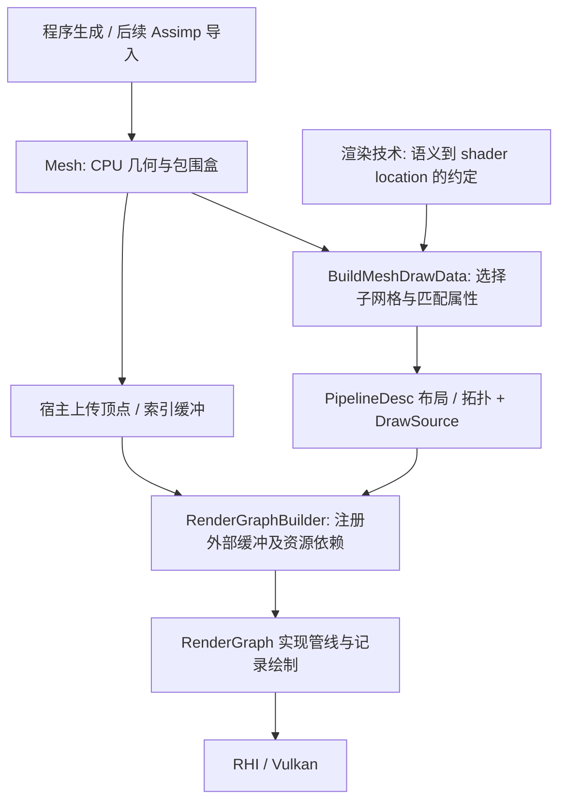

# Mesh 的设计与渲染层对接

本文对应本工作区的 CPU Mesh、绘制适配和立方体示例。测试与运行证据见 [验证记录](Mesh验证记录.md)，PR 范围见 [PR 说明](PR-Mesh.md)。状态以实际代码和验证记录为准。

## 1. 先明确资源和一次绘制的区别

`Mesh` 保存局部坐标系中的共享几何：顶点字节流、属性含义、索引、子网格范围及局部包围盒。对象的世界矩阵、实际材质、GPU 缓冲和 Vulkan 命令属于使用这份几何的其他层。

例如，两辆颜色不同的车可以共享车身 Mesh。红色和蓝色材质分别来自对象实例；车身的顶点无需重复上传。车轮需要独立旋转，则由模型节点或场景子对象持有独立变换，而不是在 Submesh 中加入变换。



当前不是一个完整的对象、模型或材质系统。`MeshDrawData` 是 CPU 侧单次绘制的准备结果；它不拥有 GPU 资源，不创建 Pass，也不选择着色器。

## 2. Mesh 中每项数据的约束

| 数据 | 含义与约束 |
|---|---|
| `vertexCount` | 所有逐顶点流共享的顶点域大小；逐实例数据不属于 Mesh |
| `layout.bindings` | 源流 ID 和每顶点步长；ID 可以不连续 |
| `MeshAttribute` | `semantic + semanticIndex + binding + format + offset`；不保存 shader location |
| `vertexStreams` | 拥有 CPU 字节；每流长度必须严格等于 `vertexCount * stride` |
| `indices` | 可选的 UInt16 / UInt32 数组；索引元素数由字节数计算 |
| `Submesh::range` | IndexedRange 或 VertexRange，决定本次绘制是否需要索引流 |
| `materialSlot` | Mesh 内的逻辑槽；模型或实例映射到实际材质；不是直接的材质句柄 |
| `localBounds` | 每个子网格覆盖自己引用的位置，总盒包含所有子盒；可保守扩大 |

位置 `Position0` 必须存在，格式为 Float3，所有坐标必须有限，包括未被引用的位置。法线、切线、UV 和颜色可以缺失；渲染技术要求的属性缺失时，适配失败，不静默填入假数据。

Normal0 为 Float3；Tangent0 为 Float4，`B = tangent.w * cross(N, tangent.xyz)`。TexCoord 允许 1/2/3 个浮点分量与多个通道，Color 允许 RGB/RGBA 与多个通道。压缩格式、骨骼和 Morph 尚未实现。

`Validate()` 检查实际位置和范围，成本为 O(顶点数 + 被引用索引数)，适合创建、编辑或上传前执行，不应在每帧逐对象调用。`RecalculateBounds(&error)` 使用 Position0 生成盒，全部成功后才提交。包围盒不计入未引用顶点，但这些位置仍必须有限。

## 3. 属性语义如何接到 shader location

Mesh 只知道 Position0、Normal0、TexCoord1 等几何含义。渲染技术声明着色器的输入契约：

```cpp
std::vector<MeshShaderInput> inputs = {
    {VertexSemantic::Position, 0, 0, rhi::VertexFormat::Float3},
    {VertexSemantic::Normal,   0, 1, rhi::VertexFormat::Float3}
};
MeshDrawData data;
if (!BuildMeshDrawData(mesh, submeshIndex, inputs, data, &error)) {
    // 向调用者报告缺失属性、格式不匹配、坏范围或坏包围盒。
}
```

这对应立方体着色器的 `layout(location=0) in vec3 aPos` 和 location 1 的法线。当前契约显式填写，不会从变量名 aPos 自动猜语义，也没有实现通用着色器语义反射。第一版要求格式精确匹配；自动重打包或格式转换需另加明确步骤。

**源 binding 不等于图的数组下标。** 当前 `RenderGraph::RecordPass` 用 `vertexStreams[i]` 绑定 GPU binding i。`BuildMeshDrawData` 因此只选择本技术需要的流，并将它们压紧到 0..N-1，同时重写管线属性引用。例如源流 7 与 2 可以映射到 GPU 流 0 与 1；宿主必须按 `sourceBindings` 输出顺序上传和注册，不能直接复制 Mesh 的流数组。

### 3.1 对实际 PipelineDesc 施加几何约束

当前采用“Mesh 提供几何描述，渲染层拥有缓冲与渲染任务”的路线。Mesh 整体无需变成 Pass 的 binding 或同步资源；渲染层将它展开为实际的顶点/索引 Buffer。与这条路线对应，现有适配层新增 `ValidateMeshPipeline`，接收真正要用于建图的 PipelineDesc，而不仅检查先前填写的属性契约。

```cpp
// pass.pipeline 的着色器和状态由渲染层选择，几何字段来自 data。
pass.pipeline.vertexBindings = data.vertexBindings;
pass.pipeline.vertexAttributes = data.vertexAttributes;
pass.pipeline.topology = data.topology;
pass.pipeline.tessPatchControlPoints = data.patchControlPoints;
if (!ValidateMeshPipeline(mesh, submeshIndex, inputs, pass.pipeline, &error)) {
    // 拒绝这个管线与 Mesh 的组合；不会静默修改管线来掩盖不匹配。
    return false;
}
// 检查成功后，渲染层再向 Builder 注册 Pass。
```

检查项包括：Mesh 自身及所选子网格有效、所需语义存在、格式符合输入契约；实际管线的 binding ID、stride、逐顶点输入率、location、format、offset 与准备好的几何输入完全一致；topology 与子网格一致；PatchList 的 tessPatchControlPoints 一致。向量顺序不影响比较，按 binding ID 和 location 匹配。空布局、只填写一半布局、额外或重复的绑定/属性会被拒绝。

这个入口要求显式顶点布局，不允许后端按 shader 猜测紧密排列而忽略 Mesh 中的 padding/stride。可以选择 Position0 等属性子集，未使用的 Mesh 通道不影响兼容性；但当前接口不接收额外的实例流。实例属性需要后续单独的输入描述。

这些是 Mesh 能够规定的几何约束。它不会决定 shader、材质、深度/混合/剔除或附件，也不会读取 SPIR-V 来证明 inputs 的语义/location 契约与 shader 一致；该契约仍由技术提供。着色器阶段、描述符和设备能力检查仍在图层/RHI。它也不是通用 SubmitMesh，不会注册 Pass、上传资源或把整个 Mesh 纳入同步。

## 4. 上传、注册和生命周期

对 `data.sourceBindings[i]` 调用 `mesh.FindVertexStream()`，取得 CPU 字节，使用 `Device::UploadBuffer` 创建 Vertex 缓冲。若 `data.indexType` 有值，再上传索引字节。上传通道以 VertexInput / VertexAttributeRead 或 IndexRead 为目标访问。

```cpp
// 示意代码：GPU 所有者必须在图执行期间一直存活。
for (uint32_t sourceBinding : data.sourceBindings) {
    const auto& bytes = mesh.FindVertexStream(sourceBinding)->bytes;
    // gpu.vertexBuffers.push_back(device.UploadBuffer(...bytes...));
}
// builder.DeclareBufferResource("CubeVB", gpu.vertexBuffers[0].get());
// pass.vertexStreams = {{"CubeVB", {}, 0}};
pass.pipeline.vertexBindings = data.vertexBindings;
pass.pipeline.vertexAttributes = data.vertexAttributes;
pass.pipeline.topology = data.topology;
pass.pipeline.tessPatchControlPoints = data.patchControlPoints;
```

当前立方体只有一个顶点流。窗口示例中的 unique_ptr 持有上传结果，RenderGraph 借用它们，先销毁图、再销毁缓冲和设备。未来资源管理器可用 MeshHandle + 数据版本缓存上传结果；当前公开字段的修改不会自动触发 GPU 更新，也没有事件或响应式属性系统。

CPU Mesh 改动后必须重新校验、重新准备绘制数据并重新上传；替换旧 GPU 缓冲前要保证相关 GPU 工作已经完成。可以释放不再需要的 CPU 字节，但此版本 `Validate()` 和重新上传仍依赖它们，因此本示例保留 CPU 数据。

## 5. 子网格范围如何变成 DrawSource

| Mesh 字段 | 对应渲染字段 | 单位 |
|---|---|---|
| `IndexedRange::indexCount` | `draw.count` | 索引元素 |
| `IndexedRange::firstIndex` | `draw.first` | 索引元素 |
| `IndexedRange::baseVertex` | `draw.vertexOffset` | 顶点，带符号 |
| `VertexRange::vertexCount` | `draw.count` | 顶点 |
| `VertexRange::firstVertex` | `draw.first` | 顶点 |
| 流在 GPU 缓冲内的起点 | `VertexStreamBinding::offset` | 字节 |
| 索引数组在 GPU 缓冲内的起点 | `IndexStreamBinding::offset` | 字节 |

`firstIndex` 不是索引字节偏移。使用整个索引缓冲时 `indexStream.offset=0`，由 draw.first 选择范围，不能再重复加同一个 firstIndex 的字节偏移。

当前图依据 `indexStream` 是否存在决定调用 DrawIndexed 或 Draw。**即使 Mesh 存有索引数据，选中 VertexRange 时也不能给这个 Pass 设置 indexStream。** 适配结果的 indexType 正是按选中范围生成。`DrawSource` 当前独立保存在 RenderPass 对象上，因此图 Build 完成后通过 `RenderPass::SetDraw(data.draw)` 设置，不能写进 RenderPassDesc 中一个不存在的 draw 字段。

## 6. 资源依赖不能绕过图

顶点流和索引流都必须先注册为图中的 Buffer。使用 `DeclarePass(name, Pass::Render, desc)` 的推导重载时，`RenderGraphBuilder::DerivePassIo` 会把这些绑定加入读集；`ResolvePassDesc` 解析资源 ID，录制时再取得实际缓冲。若使用带显式 reads/writes 集合的重载，则必须自己完整列出顶点、索引及其他实际资源，它不会自动补全读写集。

纹理、Uniform、Storage 等实际使用的资源也要进入相应 shaderBindings / 读写声明。仅传入 MaterialHandle 或在回调中私下绑定资源，不能让图获知依赖和屏障。静态纹理堆应遵守现有堆的专门约束，不能把它当成任意可写材质资源通道。

## 7. Mesh 与材质、多个对象的边界

选择着色器与固定功能状态的输入是：几何类型、渲染技术/阶段、材质外观、顶点输入、附件格式和渲染策略。材质本身不拥有 RenderGraph，也不是合并绘制的唯一依据。即使材质相同，顶点布局、管线、索引类型或范围不同也可能需要不同绘制。

对象实例持有 Mesh 引用、子网格选择、实际材质和变换。`materialSlot` 只参与默认绑定解析，Submesh 不直接构造材质。实例数据由 UBO、push constants 或后续实例缓冲提供；当前立方体的 model/viewProj 仍由 SceneUniforms 提供。

现有 RenderPass 只有一套 pipeline 和一个 DrawSource。反复对同一 Pass 调用 SetDraw 不会累积多个物体，最后一次会覆盖前面。短期可为每个子网格创建独立 Pass，并正确设置后续附件 Load、需要保留的深度 Store 和顺序；长期应在一个 RenderPass 内增加绘制任务列表，逐条切换管线、材质绑定、顶点/索引缓冲和范围。透明物体还需要另外排序。本文的单次绘制适配不是多物体渲染器。

## 8. Assimp 的后续入口

第一版导入策略是一个 aiMesh 生成一个 Mesh，初始含一个 Submesh；模型节点另外保存局部矩阵和网格引用。不要把整个 aiScene 的所有网格直接展平到一个 Mesh，并丢掉节点变换。

aiMesh 的 mMaterialIndex 是 aiScene 材质表中的下标。导入器将其映射到模型的默认绑定，Mesh 可使用逻辑槽 0。不要把这个场景下标解释成全引擎唯一材质句柄。导入时复制位置/可选通道并拥有 CPU 字节，不让 Mesh 依赖导入器内存的寿命。

第一版可三角化并按图元类型分组，点/线需明确支持或拒绝；不要假设三角化会删除点/线。生成切线、补法线、坐标系和单位转换属于导入策略，不隐藏在 Mesh::Validate 中。当前 PR 不实现导入器。

参照：[Assimp aiMesh](https://github.com/assimp/assimp/blob/master/include/assimp/mesh.h)、[aiScene/aiNode](https://github.com/assimp/assimp/blob/master/include/assimp/scene.h)、[后处理约定](https://github.com/assimp/assimp/blob/master/include/assimp/postprocess.h)。

## 9. 可观测性与验证方法

`Mesh` 是公开字段的数据结构，可读取数量、布局、范围、材质槽、包围盒，或用 FindAttribute/FindVertexStream 查询。它尚无编辑器面板、属性变更通知或自动 GPU 同步。

可观测入口有两种：CPU 程序 Engine0MeshInspect 输出实际数量、包围盒、源 binding 到 GPU binding/location 的映射及 PipelineCompatible 状态；CubeReflection 使用同一份立方体 Mesh 和适配结果上传，并在 DeclarePass 前检查实际 PipelineDesc，再建图、绘制。前者不要求 Vulkan，后者才验证 GPU 链路。CPU 测试通过不能替代图像或窗口验证。

正式测试源码在 tests 目录，不再依赖被忽略的 out/mesh-check/MeshTests.cpp。构建目录仍放在 out，CTest 的 LastTest.log 是运行证据，测试源码和记录文档则可以纳入 PR。具体命令、检查数量和本机执行结果在验证记录中给出。

## 10. 后续实现顺序

1. 保持单 Mesh 的 CPU 数据约束、绘制适配和可复现验证稳定。
2. 提取 MeshGpu 上传/缓存及资源版本管理；让更多示例共享同一条路径。
3. 用 Assimp 导入 ModelAsset，保留节点树、网格引用和默认材质绑定。
4. 定义材质外观与渲染技术的匹配，再实现多物体绘制列表。
5. 在独立几何适配层接入 SDF、Gaussian 或体素，避免把非 Mesh 几何硬塞进顶点流结构。
