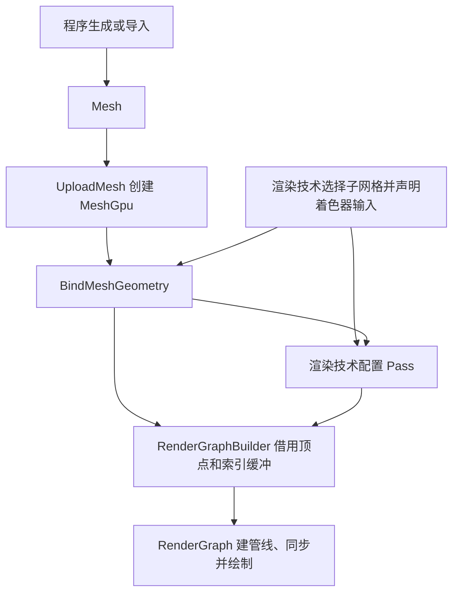

# Mesh 的设计与渲染层对接

本文对应工作区的 CPU Mesh、GPU 驻留和 RenderGraph 接入。复现命令见 [测试说明](../tests/README.md)，此前运行的结果见 [验证记录](Mesh验证记录.md)。

## 1. 先明确资源和一次绘制的区别

| 层 | 职责 |
|---|---|
| `Mesh` | 保存局部坐标中的顶点字节、属性语义和布局、索引、子网格范围及包围盒。材质槽供模型解析。 |
| `MeshGpu` / `UploadMesh` | 校验并上传静态几何，按源 binding 持有顶点缓冲和可选索引缓冲，同时保留布局及子网格快照。 |
| `BindMeshGeometry` | 用子网格和着色器输入契约生成顶点布局、拓扑、patch 大小、流绑定和绘制范围，将实际使用的几何缓冲导入图。 |
| 渲染技术与 Pass | 选择子网格、shader、材质、深度、混合、剔除和附件，配置变换、实例数、纹理、Uniform、Storage 和间接参数缓冲。 |
| RenderGraph / RHI | 创建图资源及管线，安排依赖和同步，录制绘制。全屏、计算、后处理和呈现由各自的 Pass 配置。 |

例如，两辆颜色不同的车可以共享车身 Mesh。红色和蓝色材质分别来自对象实例；车身的顶点无需重复上传。车轮需要独立旋转，则由模型节点或场景子对象持有独立变换，而不是在 Submesh 中加入变换。



Retrieve 的阴影与主场景 Pass 共用鱼模型的顶点和索引缓冲，各自选择着色器、附件和 shader 资源。鱼群位置和朝向来自计算 Pass 更新的实例数据。

## 2. Mesh 中每项数据的约束

| 数据 | 含义与约束 |
|---|---|
| `vertexCount` | 所有逐顶点流共享的顶点域大小；逐实例数据不属于 Mesh |
| `layout.bindings` | 源流 ID 和每顶点步长；ID 可以不连续 |
| `MeshAttribute` | `semantic + semanticIndex + binding + format + offset`；不保存 shader location |
| `vertexStreams` | 拥有 CPU 字节；每流长度必须严格等于 `vertexCount * stride` |
| `indices` | 可选的 UInt16 / UInt32 数组；索引元素数由字节数计算 |
| `Submesh::range` | IndexedRange 或 VertexRange，决定本次绘制是否需要索引流 |
| `materialSlot` | Mesh 内的逻辑槽；模型或实例映射到实际材质；不是直接的材质句柄 |
| `localBounds` | 每个子网格覆盖自己引用的位置，总盒包含所有子盒；可保守扩大 |

位置 `Position0` 必须存在，格式为 Float3，所有坐标必须有限，包括未被引用的位置。法线、切线、UV 和颜色可以缺失；渲染技术要求的属性缺失时，适配失败，不静默填入假数据。

Normal0 为 Float3；Tangent0 为 Float4，`B = tangent.w * cross(N, tangent.xyz)`。TexCoord 允许 1/2/3 个浮点分量与多个通道，Color 允许 RGB/RGBA 与多个通道。压缩格式、骨骼和 Morph 尚未实现。

`Validate()` 检查实际位置和范围，成本为 O(顶点数 + 被引用索引数)，适合创建、编辑或上传前执行，不应在每帧逐对象调用。`RecalculateBounds(&error)` 使用 Position0 生成盒，全部成功后才提交。包围盒不计入未引用顶点，但这些位置仍必须有限。

## 3. 属性语义如何接到 shader location

Mesh 只知道 Position0、Normal0、TexCoord1 等几何含义。渲染技术声明着色器的输入契约：

```cpp
std::vector<MeshShaderInput> inputs = {
    {VertexSemantic::Position, 0, 0, rhi::VertexFormat::Float3},
    {VertexSemantic::Normal,   0, 1, rhi::VertexFormat::Float3}
};
MeshDrawData data;
if (!BuildMeshDrawData(mesh, submeshIndex, inputs, data, &error)) {
    // 向调用者报告缺失属性、格式不匹配、坏范围或坏包围盒。
}
```

这对应立方体着色器的 `layout(location=0) in vec3 aPos` 和 location 1 的法线。当前契约显式填写，不会从变量名 aPos 自动猜语义，也没有实现通用着色器语义反射。第一版要求格式精确匹配；自动重打包或格式转换需另加明确步骤。

当前 `RenderGraph::RecordPass` 用 `vertexStreams[i]` 绑定 GPU binding i。`BuildMeshDrawData` 根据技术声明的属性选流，将源 binding 映射到连续的 GPU binding，并重写管线属性中的 binding。CubeReflection 的位置和法线分别来自源流 7 和 2，接入时映射到 GPU 流 0 和 1。

### 3.1 PipelineDesc 的几何字段

`BindMeshGeometry` 通过 `ApplyMeshPipeline` 填写 `vertexBindings`、`vertexAttributes`、`topology` 和 `tessPatchControlPoints`，并生成 `RenderPassDesc::vertexStreams`、`indexStream` 及 DrawSource。管线使用网格实际的 stride 和 offset，技术可以只声明所需属性的子集。此接口接入逐顶点流。实例数据可通过 shader 资源或 push constant 提供。

直接构造管线时，也可调用 `ApplyMeshPipeline(data, pipeline)`，或用 `ValidateMeshPipeline` 核对已填写的显式布局。后者按 binding ID 和 location 匹配，并检查输入率、stride、format、offset、拓扑和 PatchList 的控制点数。着色器阶段、描述符和设备能力由图层和 RHI 检查。

## 4. 上传、注册和生命周期

`UploadMesh` 在资源初始化时校验 Mesh，通过现有 RHI 同步上传各顶点流及可选索引数组。顶点缓冲使用 Vertex 用途和 VertexAttributeRead 访问，索引缓冲使用 Index 用途和 IndexRead 访问。

```cpp
auto gpu = UploadMesh(device, mesh, &error);
if (!gpu) return false;

// pass 已配置 shader、附件、深度状态及 shader 资源。
const auto draw = BindMeshGeometry(builder, pass, "CubeGeometry", *gpu, 0, inputs, &error);
if (!draw) return false;
builder.DeclarePass("Cube", Pass::Render, std::move(pass));

// Builder 构建图之后设置绘制范围。
static_cast<RenderPass*>(graph.FindPass("Cube"))->SetDraw(*draw);
```

多个 Pass 使用同一前缀和同一个 MeshGpu 时，同名同句柄的缓冲声明合并。若同名资源指向不同缓冲，接入返回错误。调用方持有 MeshGpu。先等待引用这些缓冲的 GPU 工作完成并销毁图，再释放 MeshGpu，最后销毁 Device。绘制使用上传时的布局和范围快照，调用方可释放原 CPU 数据。编辑几何时重新计算包围盒并上传，新图绑定新的 MeshGpu。

## 5. 直接与间接绘制的子网格元数据

| Mesh 字段 | 对应渲染字段 | 单位 |
|---|---|---|
| `IndexedRange::indexCount` | `draw.count` | 索引元素 |
| `IndexedRange::firstIndex` | `draw.first` | 索引元素 |
| `IndexedRange::baseVertex` | `draw.vertexOffset` | 顶点，带符号 |
| `VertexRange::vertexCount` | `draw.count` | 顶点 |
| `VertexRange::firstVertex` | `draw.first` | 顶点 |
| 流在 GPU 缓冲内的起点 | `VertexStreamBinding::offset` | 字节 |
| 索引数组在 GPU 缓冲内的起点 | `IndexStreamBinding::offset` | 字节 |

`firstIndex` 不是索引字节偏移。使用整个索引缓冲时 `indexStream.offset=0`，由 draw.first 选择范围，不能再重复加同一个 firstIndex 的字节偏移。

当前图依据 `indexStream` 的存在决定调用 DrawIndexed 或 Draw。`BindMeshGeometry` 为 IndexedRange 设置索引流，为 VertexRange 清空索引流。图构建后通过 `RenderPass::SetDraw` 设置 DrawSource，渲染层可按实例或帧的需要配置实例数量。

`Mesh::GetDrawMetadata(submeshIndex)` 和 `MeshGpu::GetDrawMetadata(submeshIndex)` 使用同一组几何字段。GPU 版本读取上传时的快照，原 CPU 字节释放后仍可查询。CPU 版本常数时间检查所选范围，索引值和局部包围盒的完整校验由 `Mesh::Validate()` 执行。返回空值表示下标越界或该范围缺少有效数据。

渲染层可以用 `indexType` 选择命令类型，用 `topology` 和 `patchControlPoints` 匹配管线，并用 `localBounds` 和 `materialSlot` 做可见性判断和分组。以 Vulkan 的索引命令为例，`count` 映射到 `indexCount`，`first` 映射到 `firstIndex`，`baseVertex` 映射到带符号的 `vertexOffset`。非索引命令使用同一查询的 `count` 和 `first`，分别写入 `vertexCount` 和 `firstVertex`。

```cpp
const auto geometry = gpu.GetDrawMetadata(submeshIndex);
if (!geometry) return false;

if (geometry->indexType) {
    VkDrawIndexedIndirectCommand command{
        geometry->count, instanceCount, geometry->first, geometry->baseVertex, 0
    };
    // 调用方写入自己的索引间接参数缓冲。
} else {
    VkDrawIndirectCommand command{geometry->count, instanceCount, geometry->first, 0};
    // 调用方写入自己的非索引间接参数缓冲。
}
```

实例数量、首实例、参数缓冲及其字节偏移由渲染层提供。`MeshDrawMetadata::count` 是一条命令的元素数量。`DrawSource::count` 在 Indirect 模式下表示命令条数，提交单条命令时填 1。

## 6. 资源依赖不能绕过图

顶点流和索引流都必须先注册为图中的 Buffer。使用 `DeclarePass(name, Pass::Render, desc)` 的推导重载时，`RenderGraphBuilder::DerivePassIo` 会把这些绑定加入读集；`ResolvePassDesc` 解析资源 ID，录制时再取得实际缓冲。若使用带显式 reads/writes 集合的重载，则必须自己完整列出顶点、索引及其他实际资源，它不会自动补全读写集。

纹理、Uniform、Storage 等实际使用的资源也要进入相应 shaderBindings / 读写声明。仅传入 MaterialHandle 或在回调中私下绑定资源，不能让图获知依赖和屏障。静态纹理堆应遵守现有堆的专门约束，不能把它当成任意可写材质资源通道。

## 7. Mesh 与材质、多个对象的边界

选择着色器与固定功能状态的输入是：几何类型、渲染技术/阶段、材质外观、顶点输入、附件格式和渲染策略。材质本身不拥有 RenderGraph，也不是合并绘制的唯一依据。即使材质相同，顶点布局、管线、索引类型或范围不同也可能需要不同绘制。

对象实例持有 Mesh 引用、子网格选择、实际材质和变换。`materialSlot` 只参与默认绑定解析，Submesh 不直接构造材质。实例数据由 UBO、push constants 或后续实例缓冲提供；当前立方体的 model/viewProj 仍由 SceneUniforms 提供。

现有 RenderPass 只有一套 pipeline 和一个 DrawSource。反复对同一 Pass 调用 SetDraw 不会累积多个物体，最后一次会覆盖前面。短期可为每个子网格创建独立 Pass，并正确设置后续附件 Load、需要保留的深度 Store 和顺序；长期应在一个 RenderPass 内增加绘制任务列表，逐条切换管线、材质绑定、顶点/索引缓冲和范围。透明物体还需要另外排序。本文的单次绘制适配不是多物体渲染器。

## 8. Retrieve 的 Assimp 入口

Retrieve 的 `LoadFishMesh` 延续对示例鱼模型的展平、缩放和法线处理。每个三角面按三个控制点保存为 patch，阴影和主场景采用同一个子网格。这个示例的鱼群变换由实例数据提供。

通用模型导入还需要保留模型节点的变换与网格引用，并把 aiMesh 的材质表下标映射到模型的默认绑定。导入器负责补充法线、切线和坐标单位转换，Mesh 保存导入后的独立顶点和索引字节。

参照：[Assimp aiMesh](https://github.com/assimp/assimp/blob/master/include/assimp/mesh.h)、[aiScene/aiNode](https://github.com/assimp/assimp/blob/master/include/assimp/scene.h)、[后处理约定](https://github.com/assimp/assimp/blob/master/include/assimp/postprocess.h)。

## 9. 可观测性与验证方法

`Mesh` 是公开字段的数据结构，可读取数量、布局、范围、材质槽、包围盒，或用 FindAttribute/FindVertexStream 查询。它尚无编辑器面板、属性变更通知或自动 GPU 同步。

CPU 程序 Engine0MeshInspect 输出实际数量、包围盒、源 binding 到 GPU binding/location 的映射和 PipelineCompatible 状态。CubeReflection 使用双顶点流验证上传到渲染的链路，离屏模式回读几何覆盖和合成像素。Retrieve 用同一个 MeshGpu 接入阴影和主场景。

正式测试源码在 tests 目录，不再依赖被忽略的 out/mesh-check/MeshTests.cpp。构建目录仍放在 out，CTest 的 LastTest.log 是运行证据，测试源码和记录文档则可以纳入 PR。具体命令、检查数量和本机执行结果在验证记录中给出。

## 10. 后续实现顺序

1. 保持单 Mesh 的 CPU 数据约束、绘制适配和可复现验证稳定。
2. 在资源管理层加入 MeshGpu 缓存和版本管理。
3. 用 Assimp 导入 ModelAsset，保留节点树、网格引用和默认材质绑定。
4. 定义材质外观与渲染技术的匹配，再实现多物体绘制列表。
5. 在独立几何适配层接入 SDF、Gaussian 或体素，避免把非 Mesh 几何硬塞进顶点流结构。
