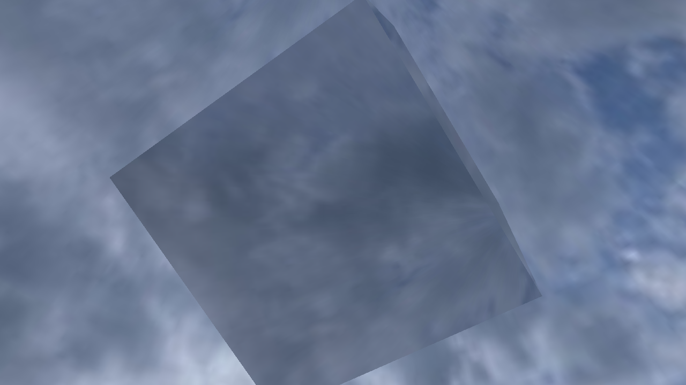

# Mesh 验证记录

执行日期：2026-11-20（Asia/Shanghai）。这些结果来自本工作区实际构建和运行，不是预计结果。代码设计见 [设计与渲染对接](Mesh设计与渲染对接.md)，通用复现说明见 [tests/README.md](../tests/README.md)。

## 1. 之前到底有没有测试

此前已在 `out/mesh-check` 使用独立测试程序执行过 68 项几何检查，但测试源、可执行文件都位于 .gitignore 忽略的 out 内，没有 CMake/CTest 入口。这能证明当时做过组件验证，却不足以让代码审阅者从仓库复现；此前也没有验证 Mesh 驱动渲染的完整链路。

现在正式测试源码在 [tests/MeshTests.cpp](../tests/MeshTests.cpp) 和 [tests/MeshDrawDataTests.cpp](../tests/MeshDrawDataTests.cpp)，属性输出程序在 [mesh_inspect/main.cpp](../Engine_0/examples/mesh_inspect/main.cpp)，均可纳入版本控制。构建产物仍在 out 中，但本目录下保留了可审阅的运行日志副本。

## 2. 本次结果

| 构建/运行 | 实际结果 | 原始日志副本 |
|---|---|---|
| GCC 16.2，CPU-only 顶层配置 | CTest 3/3：68 项几何、25 项映射、28 项实际管线约束检查和属性输出 | [mesh-cpu-gcc.txt](validation/mesh-cpu-gcc.txt) |
| MSVC 19.51，Debug，启用 GPU 测试 | CTest 4/4：上述 3 项 + GPU 离屏绘制 | [mesh-cpu-gpu-msvc.txt](validation/mesh-cpu-gpu-msvc.txt) |
| CubeReflection 窗口运行 | 120 帧，退出码 0 | [mesh-window.txt](validation/mesh-window.txt) |
| CubeReflection 手动离屏运行 | 3 帧，退出码 0，图像写入成功 | [mesh-gpu-smoke.txt](validation/mesh-gpu-smoke.txt) |

CPU 测试目标启用了 GCC 的 `-Wall -Wextra -Wpedantic -Werror` 或 MSVC 的 `/W4 /WX`。窗口示例使用原项目的构建警告设置，没有宣称整个引擎所有目标都以警告视为错误构建。

本机 GPU：NVIDIA GeForce RTX 5060 Laptop GPU；静态纹理堆路径为 bindless。所用依赖为 GLM 1.0.1、GLFW 3.5.1，以及本机 Vulkan SDK。GLM/GLFW 的临时构建与安装均在 out/mesh-deps 内；它们不是新增的仓库依赖副本，也没有改动系统安装。

CPU 属性输出为：

```text
Mesh: Cube
vertices=24 indices=36 submeshes=1
bounds.min=(-1,-1,-1) bounds.max=(1,1,1)
Position0 sourceBinding=7 -> gpuBinding=0 location=0 offset=0
Normal0 sourceBinding=7 -> gpuBinding=0 location=1 offset=12
draw=DrawIndexed count=36 first=0 baseVertex=0 materialSlot=0
Validate=PASS
PipelineCompatible=PASS
```

GPU 离屏输出中的关键结果：

```text
Mesh pipeline compatibility=PASS
Smoke image: min=79 max=205 mean=120.762
Mesh coverage pixels=339843/921600
Cube reflection smoke PASS: out/cube_reflection_smoke.png
Rendered frames=3
```

覆盖数来自 SceneColor 的 alpha；该附件清为 0，立方体片元写入 1。因此这个结果检查了几何绘制，而不仅是合成阶段的环境背景。姿态固定为动画 0.75 秒处，便于重现。它验证了当前示例的基本链路，并非所有图元、材质、驱动和场景的回归。



## 3. 本机执行命令

以下路径是本次环境的实际路径，换机器时按本机 GLM、编译器和依赖安装位置调整。

### GCC：仅 CPU

```powershell
cmake -S . -B out/mesh-tests-gcc -G Ninja `
  "-DCMAKE_C_COMPILER=gcc.exe" "-DCMAKE_CXX_COMPILER=g++.exe" `
  -DENGINE0_BUILD_RENDERER=OFF `
  "-DENGINE0_GLM_INCLUDE_DIR=D:/code/C++/Engine_0-main/out/mesh-check/deps/glm-1.0.1"
cmake --build out/mesh-tests-gcc
ctest --test-dir out/mesh-tests-gcc --output-on-failure -V
```

### MSVC：CPU 与真实 GPU

```powershell
& "D:/software/VisualStudio/product/Common7/Tools/Launch-VsDevShell.ps1" `
  -Arch amd64 -SkipAutomaticLocation | Out-Null
cmake -S . -B out/mesh-render-msvc -G Ninja `
  "-DCMAKE_C_COMPILER=cl.exe" "-DCMAKE_CXX_COMPILER=cl.exe" `
  -DCMAKE_BUILD_TYPE=Debug `
  "-DCMAKE_PREFIX_PATH=D:/code/C++/Engine_0-main/out/mesh-deps/install" `
  -DENGINE0_BUILD_RETRIEVE=OFF -DBUILD_TESTING=ON -DENGINE0_ENABLE_GPU_TESTS=ON
cmake --build out/mesh-render-msvc --target CubeReflection Engine0MeshTests Engine0MeshDrawTests Engine0MeshInspect
ctest --test-dir out/mesh-render-msvc --output-on-failure -V
.\out\mesh-render-msvc\Engine_0\examples\cube_reflection\CubeReflection.exe --frames 120
.\out\mesh-render-msvc\Engine_0\examples\cube_reflection\CubeReflection.exe --smoke 3
```

CTest 的最新原始运行日志分别为 out/mesh-tests-gcc/Testing/Temporary/LastTest.log 和 out/mesh-render-msvc/Testing/Temporary/LastTest.log。GPU CTest 图像位于 out/mesh-render-msvc/out/cube_reflection_smoke.png；手动从仓库根目录运行的图像位于 out/cube_reflection_smoke.png。

## 4. 如何对应到源码

[mesh-tested-files.sha256](validation/mesh-tested-files.sha256) 记录本次所测源码和构建描述的 SHA-256，文本统一为 UTF-8、LF 换行后计算，避免 Git 的 CRLF 转换影响比较。后续改动后应重新运行测试，并重新生成证据；不能把旧记录当作新版本通过的证明。

本次构建了 CubeReflection 及 Mesh CPU 测试目标。没有构建或运行 Retrieve，也没有宣称验证整个 Engine_0 主冒烟程序、Assimp 导入或完整对象/材质系统。代码中渲染适配是单子网格的直接绘制，尚无通用多物体绘制列表或 GPU Mesh 缓存。

当前补充了“几何资源约束实际管线”的路线：ValidateMeshPipeline 读取实际 PipelineDesc 并拒绝不匹配的几何输入，CubeReflection 在 DeclarePass 前使用它。该检查不改变 shader、材质和附件；shader 的语义/location 契约仍由技术显式声明，没有新增 SPIR-V 语义反射。
